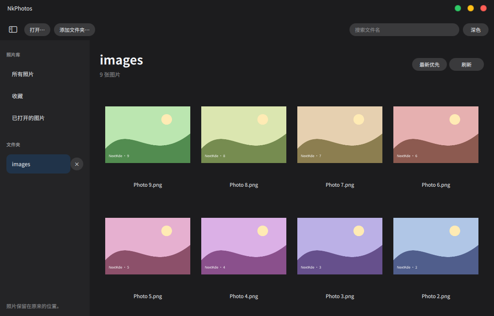

# NkPhotos

One NextKde application for photo-folder browsing and image viewing. The gallery
and single-image viewer share one executable and one Flatpak identity:
`org.nextks.photos`. Editing is delegated to NkShot; originals are not modified
by NkPhotos.

The first development version supports folder browsing, filename search, sorting,
favorites, image navigation, zoom/pan/fit, file information, Chinese/English and
light/dark appearance. It does not import or move originals. Folders are scanned
non-recursively; opening individual files shows only the explicitly opened files.
See [中文](README.zh-CN.md), [architecture](docs/Architecture.md), and the exact
[verification status and remaining integration checks](docs/Verification.md).



## Editing

NkShot is optional. The edit action asks for a destination folder and creates a
uniquely named copy before handing it to `nkshot --edit-existing`. Originals and
existing destination files are never overwritten. If the editor cannot open,
the saved copy is retained and the reason is shown. Real cross-Flatpak NkShot
handoff is still pending: the NkShot manifest inspected retains Spectacle's
upstream identity. This is a development version, not a published release.

## Controls

- Open: Ctrl+O. Add folder: Ctrl+Shift+O. Search: Ctrl+F.
- Double-click or Enter to view; arrows to navigate; Escape to return.
- Wheel or +/− buttons to zoom; drag to pan; Fit resets the view.
- Ctrl+B toggles the sidebar; F5 refreshes; F11 toggles fullscreen.
- Removing a folder only removes its library reference. Favorites keep file references.

## Development

Use the pinned Kos.Ui submodule. Build and test only in the designated VM
(`172.20.23.3`) or explicitly authorized CI, never on the maintainer workstation.

```sh
git submodule update --init --recursive
cmake -S . -B build -G Ninja -DNKPHOTOS_BUILD_TESTS=ON
cmake --build build
ctest --test-dir build --output-on-failure
```

Target runtime: `org.kde.Platform//6.11`; matching `org.kde.Sdk` is build-only.
No WebEngine, SDL, private Qt runtime or resident host service is included.
See [Flatpak instructions](packaging/flatpak/README.md). The manifest does not
grant home-directory, whole-filesystem or network access.

## Sources

Image pan/zoom is adapted from KDE Koko. Kos.Ui is the canonical NextKde shared
component library. See [NOTICE](NOTICE.md) for exact revisions and modifications.
