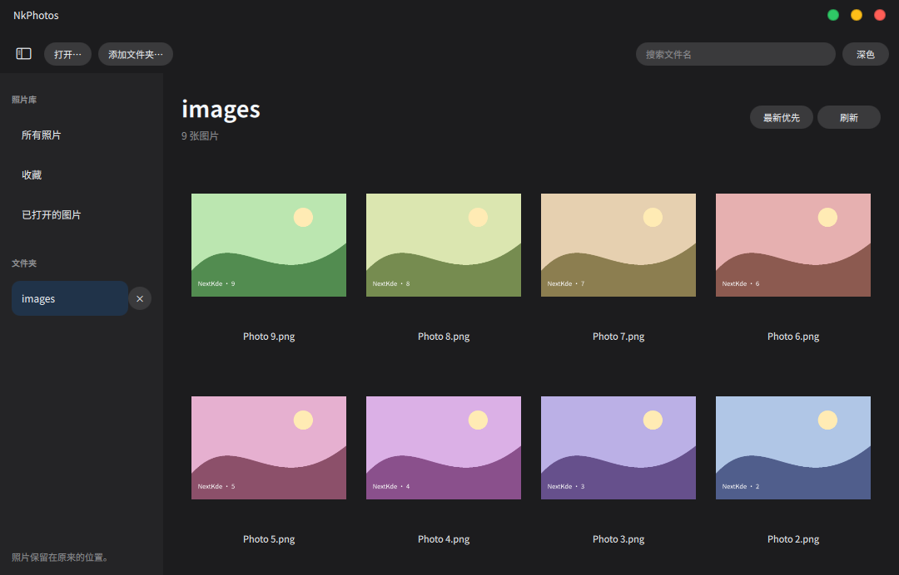

# NkPhotos

照片文件夹浏览与单图查看合为一个 NextKde 应用、一个 Flatpak 包：
`org.nextks.photos`。编辑交给 NkShot，NkPhotos 不修改原图。

首个开发版已实现文件夹浏览、文件名搜索、排序、收藏、单图翻页、缩放拖动、
适应窗口、文件信息、中英文和深浅色。只添加用户明确选择的文件夹；
不自动扫描主目录，不复制原图进入私有图库，不递归导入子目录。
单独打开图片时，只浏览明确打开的那些文件；浏览整组照片请添加文件夹。

点击“在 NkShot 中编辑”后选择副本的保存文件夹，应用创建独立副本再交给 NkShot。
不会覆盖原图或已有文件，交接失败时保留副本并显示原因。
**真实的跨 Flatpak 编辑交接尚未验收**：所检查的 NkShot 打包清单仍保留 Spectacle
旧身份，需要与 NkShot 的实际安装包对齐。当前为开发版，尚未发布正式版本。

双击或 Enter 进入看图，方向键翻页，Esc 返回；滚轮或加减按钮缩放，拖动平移。
Ctrl+O 打开图片，Ctrl+Shift+O 添加文件夹，Ctrl+F 搜索，Ctrl+B 切换侧栏，
F5 刷新，F11 全屏。从侧栏移除文件夹不会删除照片。

使用固定版本 Kos.Ui；缩放交互改编自 KDE Koko。来源见 [NOTICE](NOTICE.md)。
共用 `org.kde.Platform//6.11`；不引入 WebEngine、SDL、自建 Qt runtime 或宿主常驻服务。

构建与验证只在 `172.20.23.3` 虚拟机或明确授权的 CI 执行。本机只编辑源码和操作 Git。
构建命令见 [English](README.md)，验收状态见 [验证记录](docs/Verification.md)。
